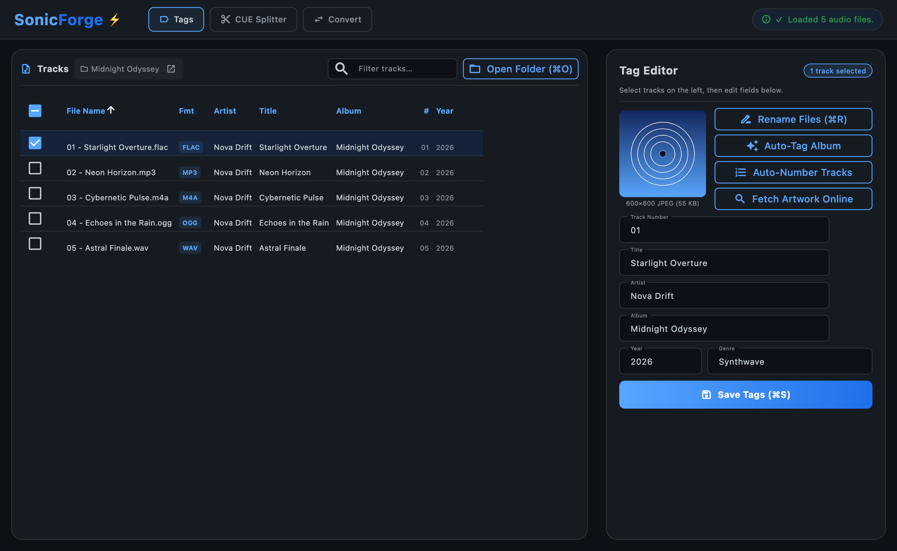
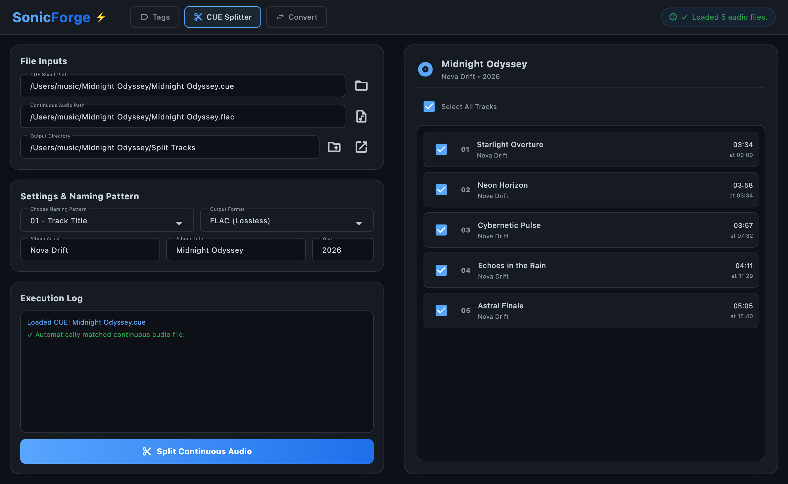
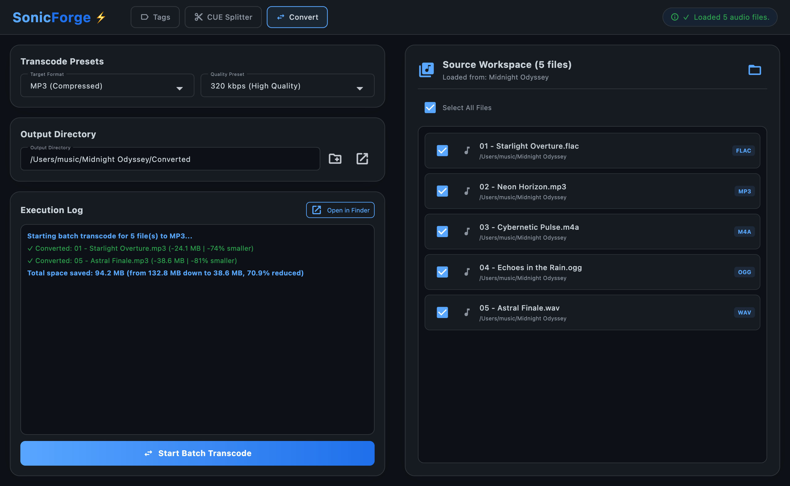

# SonicForge ⚡

A fast, zero-dependency batch audio tag editor, CUE sheet splitter, and multi-format audio transcoder for macOS, built with Python and Flet.



---

## ✨ Features

- 🎵 **Universal Audio & Tag Support**: Read and write metadata and embedded cover art across **FLAC**, **MP3** (ID3v2.3 + `APIC`), **M4A / MP4 / AAC** (`©nam`, `©ART`, `©alb`, `©day`, `trkn`, `©gen`, `covr`), **OGG Vorbis**, **Opus**, **WAV** (RIFF ID3), **AIFF**, **WavPack**, **APE**, and **WMA**.
- 📁 **Instant Parallel Loading**: Loads large music directories almost instantaneously using concurrent thread pooling (`ThreadPoolExecutor`).
- 🔍 **Sortable & Filterable Track Table**: Sort by `File Name`, `Fmt`, `Artist`, `Title`, `Album`, `Track #`, or `Year`, filter tracks in real time, and jump directly to the folder in Finder.
- ✏️ **Smart Multi-Selection & Batch Editing**:
  - Native range (`Shift+Click`) and toggle (`⌘+Click` / `Ctrl+Click`) multi-selection.
  - `< Multiple values — leave blank to keep >` hints when selected tracks have differing tags.
  - Live selection count and amber `Unsaved` change badges.
  - In-memory cover art preview with live resolution/size inspection (`600×600 JPEG`) and one-click **Revert staged art**.
- 🌐 **MusicBrainz Auto-Tagging**: Search MusicBrainz releases and preview side-by-side track mappings with automatic track-count mismatch warnings before applying tags.
- 🖼️ **Unified Online Artwork Search**: Concurrently query **iTunes** and **Deezer** for high-resolution album covers, or pick local `JPG`/`PNG` artwork.
- 🔢 **Auto-Number Tracks**: Sequentially numbers selected tracks (`01`, `02`, `03`…) in a background thread.
- 🏷️ **Batch File Renaming**: Rename files on disk using customizable tag patterns (e.g., `{track:02d} - {title}`, `{artist} - {album} - {track:02d} - {title}`) with a live **Before → After** preview dialog.
- ✂️ **Multi-Format CUE Splitter**: Slice continuous album audio files into individual tracks in parallel using a `.cue` sheet and bundled `ffmpeg`, outputting to **FLAC**, **MP3 (320 kbps)**, **M4A / AAC (256 kbps)**, **OGG Vorbis (q6)**, or **WAV** with automatic metadata and cover art injection.
- 🔄 **Parallel Batch Audio Transcoder**: Convert audio files concurrently across CPU cores to **MP3**, **M4A / AAC**, **OGG Vorbis**, **FLAC**, and **WAV**, preserving all tags and cover art with real-time space-saving metrics.
- 📦 **Zero External Dependencies (`.app`)**: Self-contained macOS `.app` bundle with `ffmpeg`, dynamic libraries, and the branded `SonicForge` client bundled inside.

---

## 📸 Screenshots

### Tag Editor (`⌘1`)


### CUE Splitter (`⌘2`)


### Batch Audio Converter (`⌘3`)


---

## ⌨️ Keyboard Shortcuts

| Shortcut | Action |
| :--- | :--- |
| `⌘O` / `Ctrl+O` | Open Audio Folder |
| `⌘S` / `Ctrl+S` | Save Tags to Selected Tracks |
| `⌘R` / `Ctrl+R` | Open Batch Rename Dialog |
| `⌘A` / `Ctrl+A` | Select / Deselect All Tracks |
| `⌘1` / `⌘2` / `⌘3` | Switch between **Tags**, **CUE Splitter**, and **Convert** tabs |
| `Shift+Click` | Range-select tracks in the table |
| `⌘+Click` / `Ctrl+Click` | Toggle individual track selection |

---

## 🗂️ Project Structure

```text
SonicForge/
├── core/                   # Business logic (multi-format metadata I/O, CUE parser/splitter, transcoder, API client, state)
├── ui/                     # Flet UI components (main app, sortable file table, tag editor, dialogs, CUE & Convert tabs)
├── utils/                  # Shared utilities (native OS dialogs, path/bundle config, icon generator, logger)
├── tests/                  # Pytest unit test suite
├── assets/                 # App icons (.icns, .png) and README screenshots
├── main.py                 # Application entry point
├── SonicForge.spec         # Zero-dependency macOS PyInstaller bundle specification
├── CHANGELOG.md            # Version history and release notes
├── requirements.txt
└── pytest.ini
```

---

## 🚀 Setup & Running from Source

```bash
# 1. Create and activate a virtual environment
python3 -m venv .venv
source .venv/bin/activate

# 2. Install Python dependencies
pip install -r requirements.txt

# 3. Launch SonicForge
python3 main.py
```

---

## 📦 Packaging a Standalone macOS `.app`

SonicForge includes a custom PyInstaller specification (`SonicForge.spec`) that bundles Python, Flet, `ffmpeg`, and all required dynamic libraries into a self-contained `dist/SonicForge.app` with zero external dependencies:

```bash
# Build dist/SonicForge.app
./.venv/bin/pyinstaller SonicForge.spec --noconfirm

# Install to /Applications
cp -R dist/SonicForge.app /Applications/
```

---

## 🧪 Testing

```bash
./.venv/bin/pytest tests/ -v
```
